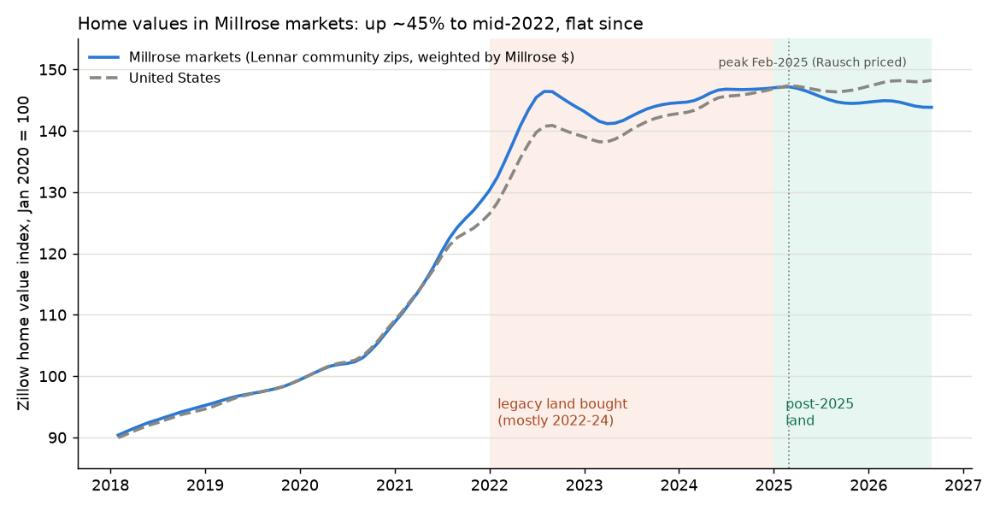

# Millrose land values: how much could builders push back, and what it means for the covenants

An illustrative sensitivity of Millrose Properties' (NYSE: MRP) **$9.6 billion land book** (homesites under option, June 30, 2026). The question: if the housing market softens, how big a **price cut on that land could homebuilders credibly demand**, and would Millrose's **credit-facility covenants** hold? Every number below can be rebuilt in Excel by copy and paste, with live formulas and check columns. Instructions are [at the bottom](#check-our-work-in-excel).

**Short answer:** on our estimates, not at today's conditions. We think it would get tight if **Lennar's sales incentives move back toward their 2025 highs (~15% of price)**, and that the covenants could be breached if that came with **moderate price weakness**. In our analysis the main variable is builder incentives and margins, not headline home prices.

*This is an illustrative sensitivity built from public filings and stated assumptions. It is not a valuation, a forecast or investment advice. Change any assumption on the `inputs` sheet and every table updates.*

## 1. What Millrose owns

| | Value | Source |
|---|---|---|
| Homesites at cost (book) | **$9.6B** | Q2 2026 10-Q |
| Expected total takedown prices (what builders pay for finished lots) | **$16.3B** | Q2 2026 10-Q |
| Development still to fund | **$6.9B** | Q2 2026 10-Q |
| Optioned to Lennar | ~68% of invested capital | Q2 2026 10-Q (Master Program Agreement vs. other agreements) |

**We believe most of the book is early-stage land**, based on our analysis of Millrose's disclosed remaining development costs ($6.9B), its split of spending since the spin-off between land ($4.9B) and development ($2.9B), and the S-11's development-stage table (Sept 2024), and assuming land is roughly half of a finished lot's cost. On that basis we estimate about **23% of the development work is done across the whole book**. We split the book by vintage using the same sources and assuming Lennar takes down the most finished lots first:

| Vintage | Book | Takedown value | Development done | Priced at (home-value index) |
|---|---|---|---|---|
| Legacy: Lennar spin-off + Rausch Coleman land, still held | ~$3.4B | ~$6.0B | ~25% (range 5–59%) | ~144 (mostly 2022–24; Rausch at the Feb 2025 peak) |
| Post-2025 additions | ~$6.1B | ~$10.4B | ~21% (range 0–34%) | ~145 |

- **We estimate land is about half of a finished lot's cost in both vintages** (43% legacy, 47% post-2025), as implied by the filings under the assumptions above.
- **The vintage split depends on one unknown:** how ~$1.9B of development spending on lots still held divides between old and new land. The range column shows the extremes. The whole-book figure (~23% developed) does not depend on it.
- **We don't see a meaningful price cushion in either vintage.** On our proxy index, home values in Millrose's markets rose ~45% from 2020 to mid-2022 and have been roughly flat since, so we believe most of the land was booked at about today's level. The purchase dates of individual parcels are not disclosed.

*Index method: Lennar's 934 active community zip codes, weighted by Millrose's disclosed dollars by state (top 10 states disclosed; the rest split by community count), chained monthly from Zillow's single-family home values (middle tier, seasonally adjusted). Data: [`home_value_index_millrose_markets.csv`](home_value_index_millrose_markets.csv).*

## 2. Method: builder margins, not home prices

Our framework assumes a builder keeps taking down lots only while it can earn a normal margin on the homes it builds on them. On that view, the most it can afford to pay for a lot is:

> today's lot price + (builder's gross margin today − normal gross margin) × home price

We assume that once the agreed takedown price exceeds that by more than the **10% the builder forfeits by walking away** (a 5% option deposit plus a 5% termination fee, both on the takedown price, under the Master Option Agreement), it could credibly push for a cut. In practice, pooling, termination-fee caps and the builder's relationship with Millrose could make the real threshold higher or lower.

| Input | Value | Source |
|---|---|---|
| Lennar gross margin | **16.6%** (fiscal Q3 2026, excl. items); peak 29.5% (Q2 2022) | Lennar earnings releases |
| Normal gross margin | **20% central.** Big-builder median excl. the 2020–25 boom: ~19%; Lennar's own: ~21.4% | 7 builders' SEC filings, 1996–2025 ([`margins`](4_margins_summary.tsv)) |
| Lennar sales incentives | **12.0%** of price; high 14.6% (Q4 2025); 1.5% at the 2022 peak; Lennar calls 4–6% "normalized" | Lennar releases |
| Lot share of home price | ~30% ($113k average Millrose takedown ÷ $372k Lennar average price) | Millrose and Lennar filings |

**Why margins, not Zillow:**
- **In our view, builders discount mainly through incentives, not sticker prices.** Lennar books incentives (price discounts and mortgage-rate buydowns) as a reduction of revenue, so they come straight out of gross margin. Zillow and the Census new-home price index don't see them.
- **New-home sticker prices have historically fallen less than Zillow.** In 2006–11, the Census constant-quality new-home index fell about half as much as Zillow (US −13.5% vs. −23%; South −7% vs. −21%); we believe much of the rest of the adjustment went through incentives, which the index doesn't capture ([`newhome`](10_newhome_vs_zillow.tsv)).
- **Since 2022, Lennar's margin fell 13 points while industry sticker prices (Census index) rose about 8%.** By our estimate, about 60% of the drop reflects incentives (2.5% → 12% of price), assuming costs otherwise kept pace with pre-incentive prices. The rest appears to be costs rising faster than prices, which Lennar attributes mainly to **higher land costs** (partly offset by construction costs down 14% per square foot since late 2023). See [`lennar`](5_lennar_quarterly.tsv).

So the scenarios use **two inputs**: the change in new-home sticker prices (linked to Zillow) and Lennar's incentive rate.

## 3. Results: haircut builders could credibly ask

These are our estimates under stated assumptions, not predictions. Central case: 20% normal margin, construction costs unchanged over 12 months. Shown in $ and as % of Millrose's $9.6B book (Lennar-optioned land only); ranges in brackets cover normal margins of 19%–21.4%.

| New-home sticker price, next 12 months ↓ / Lennar incentives → | 6% ("normal") | **12% (today)** | 15% (2025 high) |
|---|---|---|---|
| **Base: Zillow forecast** (+0.5% for Millrose markets → new-home ≈ +0.3%) | 0 | **≈$0** ($0–0.5B) | **$1.0B, 11%** ($0.7–1.5B) |
| **Moderate:** Zillow −5% (new-home ≈ −2.5%) | 0 | **$0.9B, 9%** ($0.5–1.4B) | **$1.8B, 19%** ($1.5–2.3B) |
| **Severe:** new-home −5% (≈ Zillow −10%) | 0 ($0–0.2B) | **$1.6B, 16%** ($1.2–2.1B) | **$2.5B, 26%** ($2.2–3.0B) |

- **We estimate that today Millrose's lots are worth about 8–16% less to Lennar than their agreed takedown prices**, close to the 10% walk-away line, assuming a 19–21.4% normal margin and that Lennar's blended margin is representative of Millrose lots.
- **In our analysis, incentives matter most.** At ~6% (Lennar's "normal"), we find no credible haircut in any scenario; back at ~15%, we estimate about $1B even with flat prices.
- **Zillow's forecast for Millrose's markets is +0.5%**, but 31% of the dollars are in zip codes forecast to fall (Texas −0.5%), and Zillow has been too optimistic recently.
- **The vintage split appears to change the totals little:** on our proxy index, each vintage was booked within about ±2% of where home values are forecast to be in 12 months.

## 4. Covenants

Credit agreement (March 2026), Section 7.27. All tests are on **book values**, so they only bite through write-downs or renegotiated prices.

| Test | Level |
|---|---|
| Leverage ratio (net debt ÷ (net debt + tangible net worth)) | **≤ 45%**. Up to 50% for five quarter-ends after a "Material Acquisition" (one acquisition of property ≥ 10% of total assets), if elected in writing while no default exists; max two elections |
| Minimum tangible net worth | **≥ $4.39B** (+50% of equity issued after 2025), about **$1.46B** below current equity |
| Interest coverage | ≥ 1.5× |

A breach is an immediate event of default under Section 8.3, with no cure period. The senior notes have no leverage test.

**Leverage path (our estimates):** 29.7% at June 30 → ~33–37% after the October 2026 raise ($1.0B notes + $0.5B term loan), assuming the revolver was repaid → **~41%** once the Dream Finders/Beazer homesites (up to $1.25B; $500M of 2031 notes must be redeemed if that merger doesn't close by May 13, 2027) are funded from the leftover proceeds plus the revolver.

**Estimated write-down room** before a breach ([`covenants`](7_covenants.tsv)), assuming equity stays near $5.85B and no new equity is issued:

| Situation | Room | Binding test |
|---|---|---|
| Dream Finders/Beazer funded, no step-up | ~$0.84B | 45% cap |
| Step-up elected (needs one acquisition ≥ ~$1.05–1.1B; may not apply if the homesite purchase is ~$0.8B or split into tranches) | ~$1.46B | Net-worth floor |

**Over time we think it depends on takedowns** ([`leverage`](8_leverage_path.tsv), quarterly Q1 2027–Q2 2028; illustrative paths, not forecasts):

| Path | Room in Q4 2027 (no step-up / step-up) |
|---|---|
| A. Status quo: keep buying ~$0.5B of land a quarter, no new equity | breached (−$0.4B) / $0.7B |
| B. Discipline: no new land beyond Dream Finders/Beazer | $1.45B / $1.45B |
| C. Builders slow takedowns 30% for a year; Millrose accommodates | $0.8B / $1.45B |
| D. Lennar pause: takedowns −60%, half option fees; development continues | breached (−$1.2B) / $0.05B |
| E. Same pause, development deferred with takedowns | $0.6B / $1.15B |

**Putting it together (our reading):**
- **Likely fine** at today's conditions.
- **Could get tight** if incentives return to ~15%, or with moderate price weakness at today's incentives (~$0.9–1.0B), unless Millrose stops buying new land or elects the step-up.
- **Could be breached** with moderate weakness plus 15% incentives, or in the severe case (~$1.6–2.5B), which would exceed the ~$1.46B net-worth ceiling and would likely require an amendment or new equity.
- **The most adverse sequence we model** is a Lennar pause while Millrose keeps funding development (path D): leverage would rise even before any write-down. We have not confirmed whether development funding can be deferred during a pause.

## 5. Why we think the real path would likely be slower and milder

1. **We would not expect write-downs while builders keep paying.** Contracts limit cherry-picking:
   - pooling: walking away from one community forfeits deposits across the pool, and Millrose can end the builder's options on the rest of it;
   - termination fees capped at $50M per pool (spin-off land) and $25M per pool (later land);
   - Lennar relies on Millrose for its land-light model, which we believe gives it reason to avoid walking away.
2. **We expect the first levers to be pauses and fee cuts, not price cuts:**
   - **Market pause:** triggered when the Burns home value index for a metro is down 10% or more from a property's own effective date; 2 + 2 six-month pauses at half the option rate.
   - **Discretionary pause:** costs Lennar its right to match lower option rates Millrose gives other builders.
3. **Metros past the trigger** ([`pause`](9_pause_trigger.tsv), Zillow used as a stand-in for Burns, measured from Feb 2025):
   - past −10% today: **Punta Gorda and Cape Coral**, ~1.7% of the land (~$0.17B);
   - on Zillow's 12-month forecast: add **Austin and Sherman, TX** (~$0.34B in total);
   - metros holding ~47% of the land are already down 2.5% or more on Zillow, so a further ~7.5% fall could push them past, if Burns moves similarly.
   - Only properties whose own effective date precedes the decline qualify, so actual triggered amounts are smaller.

**What could make it worse:**
- Lennar's margin is blended with its own land, which we believe is cheaper; margins on Millrose lots may be lower.
- Lennar's selling costs rose ~1 point in 2025.
- Other builders (~32% of the book) are not modeled.
- Millrose still has $6.9B of development to fund.
- Taking back partly developed land would mean selling at bigger discounts.

## Files

| File (paste into sheet) | What it is |
|---|---|
| [`1_inputs.tsv`](1_inputs.tsv) → `inputs` | Every disclosed figure (with source) and every assumption. **Edit column B.** |
| [`2_vintages.tsv`](2_vintages.tsv) → `vintages` | Legacy vs. post-2025 split: S-11 stage mix, takedowns of the most finished lots first, development spend |
| [`3_builder_margins.tsv`](3_builder_margins.tsv) → `builders` | Gross margin excl. impairments, SG&A, prices: Lennar, D.R. Horton, Pulte, NVR, Toll, Meritage, Taylor Morrison, FY1996–2025, each row with its SEC source |
| [`4_margins_summary.tsv`](4_margins_summary.tsv) → `margins` | Average margins by builder and period, and the median |
| [`5_lennar_quarterly.tsv`](5_lennar_quarterly.tsv) → `lennar` | Lennar price, margin and incentives by quarter since 2019; how much of the margin drop incentives explain |
| [`6_haircut.tsv`](6_haircut.tsv) → `haircut` | The scenario table in section 3 |
| [`7_covenants.tsv`](7_covenants.tsv) → `covenants` | Leverage and write-down room for each funding case |
| [`8_leverage_path.tsv`](8_leverage_path.tsv) → `leverage` | Quarterly cash flow, leverage and covenant room, paths A–E |
| [`9_pause_trigger.tsv`](9_pause_trigger.tsv) → `pause` | 164 metros: share of land, Zillow change since Feb 2025, forecast, trigger flags |
| [`10_newhome_vs_zillow.tsv`](10_newhome_vs_zillow.tsv) → `newhome` | Census constant-quality new-home index vs. Zillow (US, South, West), 1996–2025, with bust ratios |
| [`builders_quarterly_all.csv`](builders_quarterly_all.csv) | Data only: all 7 builders' quarterly figures since 2019 |
| [`home_value_index_millrose_markets.csv`](home_value_index_millrose_markets.csv) | Data only: the index in the chart |

## Check our work in Excel

The files are tab-separated text: columns split automatically when pasted, and every cell starting with `=` becomes a live formula. Nothing needs downloading. Needs Excel 2010 or later (365 recommended).

1. Open a **new, blank Excel workbook** and create 10 sheets named exactly **`inputs`**, **`vintages`**, **`builders`**, **`margins`**, **`lennar`**, **`haircut`**, **`covenants`**, **`leverage`**, **`pause`**, **`newhome`**. The formulas refer to these names.
2. For each file in the table above: open it on GitHub, click **Raw**, press **Ctrl+A** then **Ctrl+C**, click cell **A1** on the matching sheet and press **Ctrl+V**. Paste `1_inputs.tsv` first.
3. Wait a few seconds for Excel to finish calculating.
4. **Check:** every cell in each **check** column should be **0**. A 0 means Excel's formula reproduces our number. The checks compare against our base case, so change inputs only after checking.

**Try your own assumptions** on the `inputs` sheet, column B:
- `normal_gm`: try 0.19 or 0.214.
- `lennar_gm` and `lennar_incentives`: update each quarter from Lennar's earnings release.
- `cost_response`: 0.43 lets construction costs fall with prices.
- `legacy_dev_share_override`: 0 or 1 to see the vintage extremes.
- `zillow_fc`: replace with a newer forecast.

The `haircut`, `covenants`, `vintages` and `leverage` sheets update instantly; the check columns will then show differences from our base case, which is expected.

## Sources

- Millrose: [Q2 2026 10-Q](https://www.sec.gov/Archives/edgar/data/2017206/000119312526332732/ck0002017206-20260630.htm), [Q1 2026 10-Q](https://www.sec.gov/Archives/edgar/data/2017206/000119312526208995/ck0002017206-20260331.htm), [FY2025 10-K](https://www.sec.gov/Archives/edgar/data/2017206/000201720626000002/ck0002017206-20251231.htm), [FY2024 10-K](https://www.sec.gov/Archives/edgar/data/2017206/000119312525068773/d931976d10k.htm), [S-11/A (Jan 2025)](https://www.sec.gov/Archives/edgar/data/2017206/000119312525005370/d811267ds11a.htm), [credit agreement (Mar 2026, 8-K Ex. 10.1)](https://www.sec.gov/Archives/edgar/data/2017206/000119312526127640/d68102dex101.htm), [Oct 2026 notes 8-K](https://www.sec.gov/Archives/edgar/data/2017206/000119312526415565/d151159d8k.htm), [Sept 2026 offering release](https://www.sec.gov/Archives/edgar/data/2017206/000119312526397284/d244618dex991.htm).
- Lennar: [fiscal Q3 2026 earnings release](https://www.sec.gov/Archives/edgar/data/920760/000162828026062287/ex991-2026831x8kq3.htm), [FY2025 10-K](https://www.sec.gov/Archives/edgar/data/920760/000162828026003870/len-20251130.htm). Other builders: SEC 10-K, 10-Q and earnings releases (one link per row in `builders`).
- Census: [constant-quality new-home price index](https://www.census.gov/construction/nrs/xls/price_sold_cust.xlsx). Zillow Research: home value index and forecasts (zip and metro files, forecasts based Aug 2026). The Burns index is a paid series; Zillow is used here only as a stand-in.

**Main assumptions and limits:**
- The 20% normal margin, the 30% lot share and the 10% walk-away cushion.
- Lennar's blended margin stands in for margins on Millrose lots.
- The S-11 stage mix (Sept 2024), and takedowns of the most finished lots first.
- The development spend split between vintages.
- A Zillow-based proxy for where the land is (Lennar's communities, not Millrose's parcels).
- Census new-home prices are contract prices and don't net out incentives.

[← Back to the main page](../README.md)
