# Millrose Properties Inc. (MRP): 3Q26 Preview – Has the company paused SFR strategy?

**Rating:** Buy (reiterated) | **12-month price target:** $[xx] (from $[xx]) | **Price:** $[xx] | **Dividend yield:** [xx]%

*The land-book stress test is published separately. This page covers the rental-home program. An [exhibit guide](#exhibit-guide-rebuild-every-chart-in-excel) at the bottom explains how to rebuild every chart in Excel.*

## Our view in brief

We reiterate our Buy rating on Millrose Properties (MRP). Since we initiated on [xx], shares have returned [xx]% (TR) versus [xx]% for the RMZ and [xx]% for the S&P 500. The stock briefly traded up to book value per share in late summer 2025, as MRP deployed $2.4bn outside its original Master Program Agreement, well ahead of its initial target of over $1bn of net new capital for land acquisition and development funding. Shares have since de-rated to ~[0.X]x book as the homebuilder selling environment weakened and rates rose into September, and two new questions have weighed on the stock: (1) MRP's move into single-family rental (SFR) homes, and (2) how exposed the land book is if builder economics keep deteriorating.

We have worked through both questions using public county deed records, rental listings and company filings. Our conclusions:

- **The rental-home program is small relative to its book value.** We linked 1,107 homes in 17 states to Millrose (≈$310mn of estimated spend, ~3% of the $9.6bn homesite book).
- **We believe Millrose has paused its investments in rental homes.** Where signing dates are public (~40% of homes), ~87% were signed on or before August 31, and we find no new home deeds to Millrose recorded after October 5 in counties whose records run through mid-October.
- **If scale of deployments is restricted to current investments, downside risk to MRP's book value is negligible.** Even if we assume draconian outcomes for this pilot investment, we estimate the risk to MRP's book value is ~1% (or less than $0.50 p.s.)

## 1. The rental-home program: what the public records show

**What changed.** On September 1, MRP filed an 8-K amending the Founder's Rights Agreement to expand its business to include the acquisition and operation of single-family rental homes. The amendment redefines "Excluded Capital" to include all funding dedicated to rental homes and the first $2bn of other raised capital, allowing MRP to finance rental acquisitions without triggering existing capital priority or collateral consent rights.

**Scale.** Using county deed and parcel records, we have linked 1,107 homes across 17 states to Millrose (Exhibit 1), concentrated in Texas (349), Florida (142), South Carolina (128) and North Carolina (114). The homes are held by MRP Liberty LLC, the Millrose subsidiary named on the deeds. We estimate total spend of ~$310mn, using recorded prices where disclosed and estimates elsewhere (Texas does not disclose sale prices). Some counties cannot be searched online, so the true count may be somewhat higher. Even so, we believe the program is small relative to MRP's $9.6bn homesite book (Exhibit 9).

**Exhibit 1: Homes linked to Millrose, by state**
*Homes deeded to Millrose (via its subsidiary MRP Liberty LLC), Aug-Oct 2026 (n=1,107)*

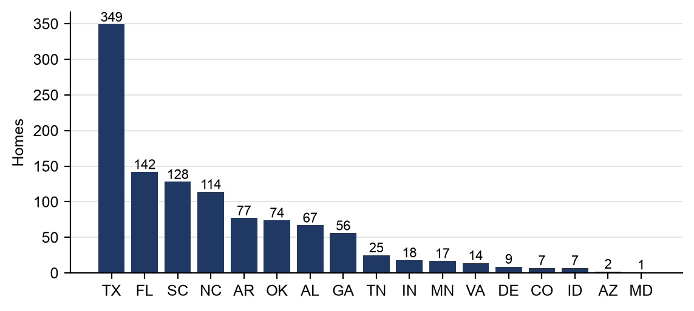

Source: County deed and parcel records, Evergreen Live rental listings, realtor.com/MLS price histories

**Exhibit 9: Rental homes are ~3% of the homesite book**
*$ billions, as of Q2 2026 (rental-home spend estimated, Aug-Oct 2026)*

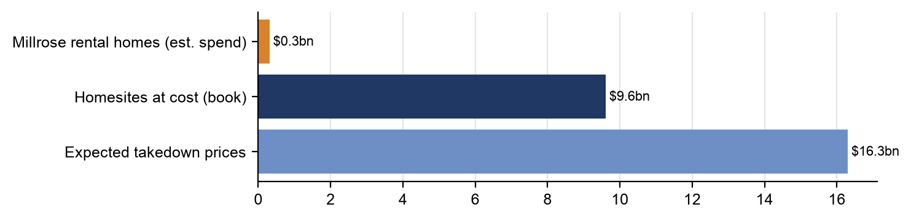

Source: Millrose Q2 2026 10-Q, county deed records

**Timing and pace: most homes appear to have been sold in the final days of August.** Recording dates understate how concentrated the purchases were in late August, because county recorders log a deed days to weeks after it is signed. By recording date, about 33% of dated deeds were recorded on or before August 31 and a further ~60% in the first two weeks of September (Exhibit 2). On a signing-date basis the picture is much more concentrated. For the 433 homes (~40% of the total) where the deed's signing date or the assessor's sale date is public, ~87% were signed in the week leading to August 31 (Exhibit 2b), with a typical lag of about a week before recording. That sample is weighted to Texas, South Carolina and Arkansas, but we see no reason the timing would differ elsewhere: in Marion County, FL, for example, deeds recorded in early September carry August sale dates. We therefore believe most of the homes were sold to Millrose in the last days of August.

**Millrose appears to have paused its deployments into rental homes.** A smaller burst followed the flurry of late-August sales (around the end of September). In our most recent, re-check of ~190 searchable counties, we found no home deed to Millrose recorded after October 5, even though most county indexes were current to October 12–19. We believe this is evidence of the fact that MRP has paused its purchases of homes in recent weeks in response to investor concerns (including the risk-adjusted return profile of these investments), and we believe an official decision could be communicated at earnings.

**Exhibit 2: Deeds were recorded from Aug 27 (the amendment date) through early September, then slowed; the last was a closing of 6 rental homes on Oct 7, with none since**
*% of dated homes deeded to Millrose (n=1,039; sums to 100%), by recording date (or assessor deed/sale date where the recording date is not shown); dark bar = Aug 24-31, the last week of August (the rental-home amendment is dated Aug 27; no deeds were recorded Aug 24-26 other than 1 county index entry). Deeds recorded in early September were mostly signed in late August. Before Aug 24 = 1 older deed. 4 Henrico, VA homes have only a weekly date range (Aug 26-Sep 1) and are shown in Aug 24-31. Oct 6-12 = a single closing of 6 rental homes in Forsyth County, NC (Oct 7); no deeds Oct 8-19.*

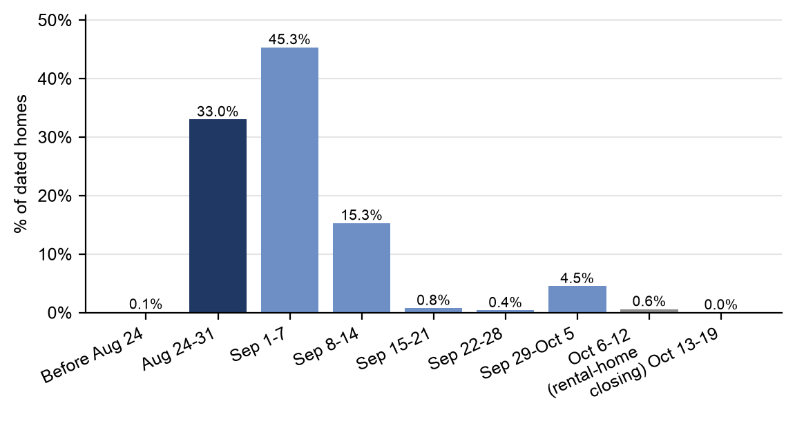

Source: County deed records (searched through Oct 19, 2026; most indexes current to Oct 12-19)

**Exhibit 2b: On a signing-date basis, ~87% of sampled homes were signed in Aug 24-31, the last week of August**
*% of sampled homes by deed signing date or assessor sale date, where public (sample of 433 homes, sums to 100%; ~40% of the total; weighted to TX, SC and AR). Aug 24-31 includes 25 Horry County, SC assessor sale dates of Aug 24-25, likely contract or deed-preparation dates; all other dates in that week fall on Aug 27-31. Earlier dates on the same parcels (prior transactions) excluded.*

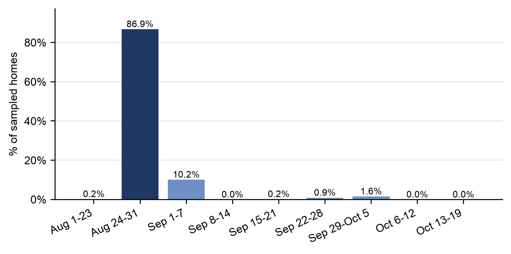

Source: County deed indexes, appraisal-district and assessor records

**Pricing.** In our data, MRP paid a median 3.2% below the last asking price (mean −2.9%) for 302 homes with both a recorded per-home price and a verified address; about a quarter were bought above the last asking price (Exhibit 3). Homes were listed a median of 79 days before MRP bought them (Exhibit 4), and most were bought for $200–350k (average ~$289k; Exhibit 5).

**Exhibit 3: MRP paid a median 3.2% below the last asking price**
*MRP purchase price vs. last list price, homes with a recorded per-home price and verified address (n=302; median -3.2%, mean -2.9%)*

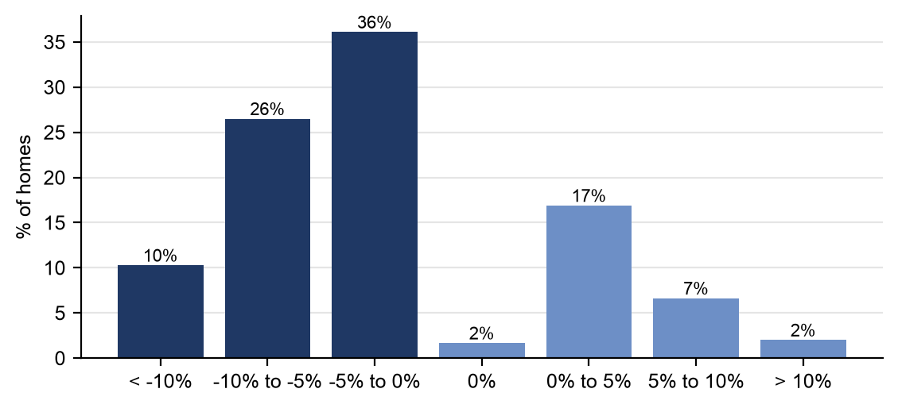

Source: County deed records, realtor.com and MLS price histories

**Exhibit 4: Homes were listed a median 79 days before MRP bought them**
*Days from first list date to MRP deed (n=338)*

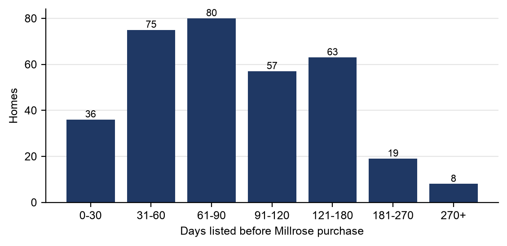

Source: realtor.com and MLS price histories, county deed records

**Exhibit 5: Most homes were bought for $200-350k (average $289k)**
*Recorded MRP purchase price per home (n=566; Texas does not disclose prices)*

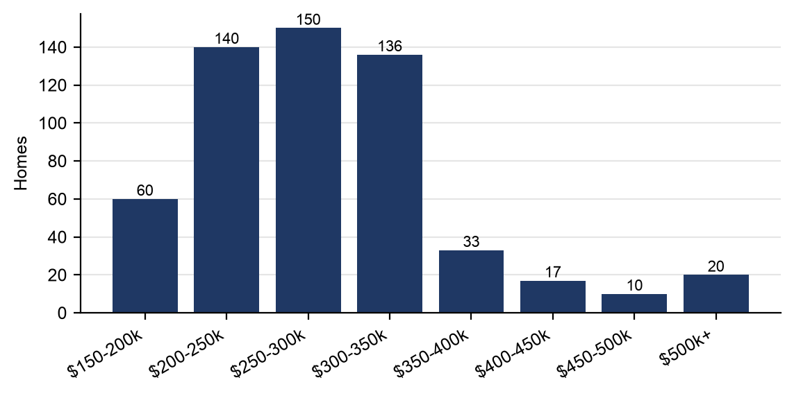

Source: County deed records

**Location.** Millrose's rental homes sit on the outer edges of their metros. On a zip-code weighted-average basis, the median MRP rental home is in zipcode area with ~364 people per square mile, ranking in the 23rd percentile of its metro (i.e., more outlying than where ~77% of the metro's residents live). That is relatively in line with new-home communities in the same markets (24th percentile), but below the two largest public single-family rental owners, AMH (33rd) and Invitation Homes (42nd) (Exhibit 5b) which have more scattered site inner ring product.

**Exhibit 5b: Millrose's rental homes are in less dense, more outlying zip codes than AMH and Invitation Homes, in line with new-home communities**
*Median zip-code population density (people per square mile) and median percentile within metro (share of the metro's residents living in less dense zip codes); Millrose n=1,062 homes, new-home communities n=1,376, AMH n=3,361, Invitation Homes n=3,461*

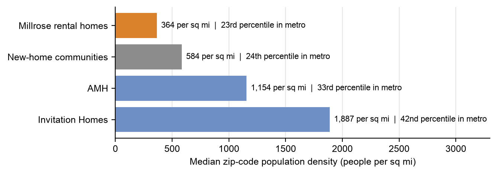

Source: US Census (ZCTA population and land area), county deed records, company websites and listings

**Rents.** The location shows up in rents. In the 14 metros where Millrose, AMH and Invitation Homes all have homes listed for rent, Millrose's average asking rent is ~$1,810/month, ~16% below AMH (~$2,160) and ~11% below Invitation Homes (~$2,030), weighting each metro by Millrose's homes (Exhibit 5c). The gap is not explained by size: per square foot, Millrose asks ~8–10% less, and comparing homes with the same number of bedrooms in the same metro, ~14–19% less. We believe the discount mainly reflects location.

**Exhibit 5c: Millrose asks ~11-16% less rent than AMH and Invitation Homes in the same metros**
*Average asking rent ($/month) for homes listed for rent, Millrose's five largest shared metros and all 14 metros where all three have listings (weighted by Millrose homes per metro; Millrose n=353, AMH n=1,974, Invitation Homes n=3,094). Asking rents on vacant homes, before any move-in concessions.*

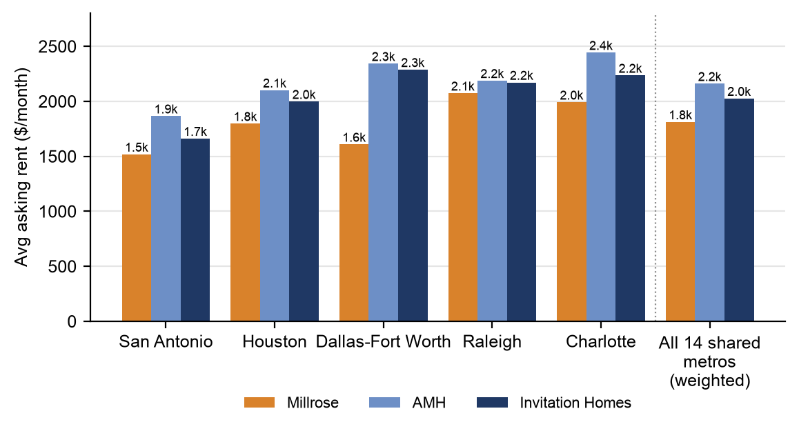

Source: Evergreen Live, AMH and Invitation Homes rental listings (Oct 2026), US Census zip-to-metro mapping

**Rentals.** Our checks show that ~94% of the homes (1,036) are currently advertised for rent by MRP's property manager, Evergreen Live, at an average asking rent of ~$1,870/month (Exhibit 6). We believe this suggests most homes are being leased up after purchase rather than acquired tenanted. That adds some lease-up risk, though we think the scale is modest.

**Exhibit 6: Gross yields average ~8.2%; we estimate NOI yields of ~4-5.5% after property expenses**
*Bars: average gross yield (annual asking rent / Millrose purchase price) by state. Red dots: estimated NOI yield = gross yield x 60% NOI margin (net of vacancy, property taxes, insurance, management and repairs; likely lower in high-tax, high-insurance states such as FL). Texas is not shown because it does not disclose sale prices.*

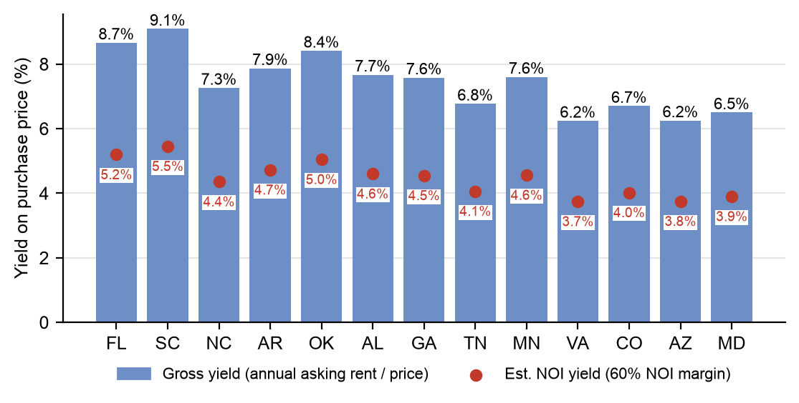

Source: Evergreen Live listings (Oct 2026), county deed records

**Discounts to deed prices.** The yields above are based on recorded deed prices, which may overstate what MRP actually paid. Bulk buyers of builder homes can receive discounts or credits that do not appear on the deed: Invitation Homes disclosed in its November 17, 2025 investor presentation that it had acquired scattered-site homes from ~10 homebuilders at discounts of up to 20% to list prices, and a 10–15% discount to market value on a forward-purchase community (Westfield Village, Atlanta). Those figures are relative to list prices and market value; MRP's deed prices were already a median ~3% below the last asking price. If MRP's true cost were 5–20% below the deed prices, gross yields would rise to ~8.6–10.3% and NOI yields to ~5.2–6.2% (Exhibit 6b). At a 10–15% discount, in line with Invitation Homes' forward-purchase case study, NOI yields would be ~5.5–5.8%.

**Exhibit 6b: A 10-15% discount to deed prices would lift NOI yields to ~5.5-5.8%**
*Average gross yield (annual asking rent / cost) and NOI yield (60% NOI margin) if MRP's cost were 0-20% below the recorded deed prices; 0% = deed-price basis (~8.2% average gross yield, Exhibit 6)*

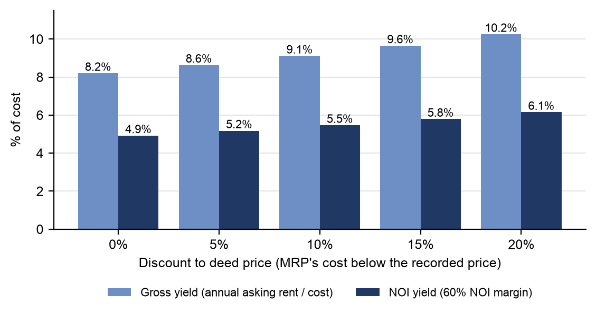

Source: County deed records, Evergreen Live listings (Oct 2026), Invitation Homes investor presentation (Nov 2025)

**Returns.** We estimate the portfolio unlevered IRR under three home price scenarios (Exhibit 7), assuming a 60% NOI margin and 3% annual rent growth after year one. In a downside scenario, with home prices down 2% in year one and flat thereafter, the IRR is ~3.3% over three years and ~4.1% over five. In a middle scenario, with Zillow's 12-month zip-code forecast in year one (~+0.6% on average) and 3% a year thereafter, the IRR is ~6.0–6.7% over a 3–5 year hold. In a stretch scenario of 5% home price growth every year, the 5-year IRR reaches ~9.0%, in line with the ~9% weighted-average yield on the monthly option payments across MRP's land-banking portfolio. These IRRs assume MRP paid the deed price. If its true cost was below the deed price, and assuming retail buyers receive similar discounts (so the homes are worth what MRP paid, with no gain on purchase), returns rise modestly through the higher yield on cost: at a 10% discount, the 5-year IRR is ~7.3% in our middle scenario and ~4.7% in the downside scenario (Exhibit 7c), and at a 20% discount, ~5.4–10.2% across our three scenarios (Exhibit 7b). The main risk is the home-price outlook. On our zip-code-weighted index of Millrose's markets (new-home community zip codes, weighted by Millrose's land dollars by state), home values have been flat since mid-2022 and are ~2% below their February 2025 peak, while the US index has kept rising (Exhibit 8).

**Exhibit 7: Unlevered IRR of ~4-9% over five years at deed prices depending on home prices; ~6.7% in our middle scenario**
*Portfolio unlevered IRR by hold period for 528 homes with a recorded price, asking rent and Zillow zip forecast; cost = deed price; 60% NOI margin, 3% rent growth after year 1, 3% selling costs. Home price scenarios as labeled.*

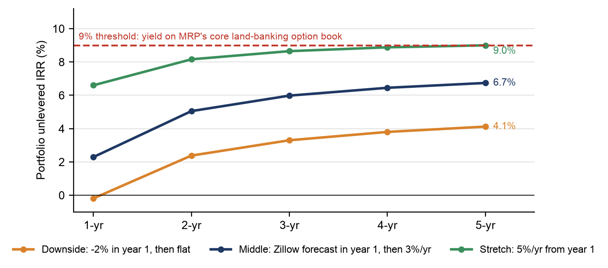

Source: County deed records, Evergreen Live listings, Zillow

**Exhibit 7b: At a 20% discount to deed prices, 5-year unlevered IRRs rise to ~5-10%; ~8.0% in our middle scenario**
*Same as Exhibit 7, but with MRP's cost 20% below the deed price and home values starting at that cost (retail buyers assumed to receive similar discounts, so no gain on purchase).*

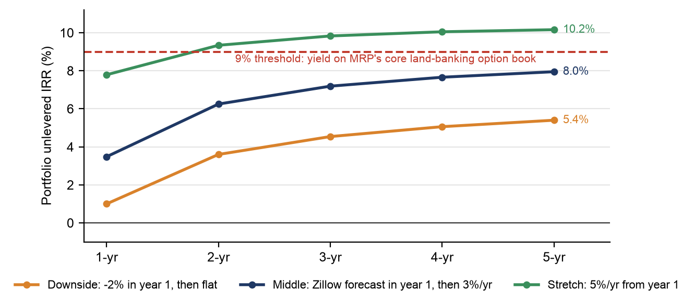

Source: County deed records, Evergreen Live listings, Zillow, Invitation Homes investor presentation (Nov 2025)

**Exhibit 7c: Even at a 20% discount to deed prices, MRP would need ~3.7% annual home price growth to reach a 9% IRR**
*Left: constant annual home price growth (from year 1) needed for a 9% portfolio 5-year unlevered IRR. Right: 5-year IRR in our middle and downside scenarios (Exhibits 7 and 7b). By discount of MRP's cost to the recorded deed price; home values start at MRP's cost (retail buyers assumed to receive similar discounts); 528 homes; 60% NOI margin, 3% rent growth, 3% selling costs.*

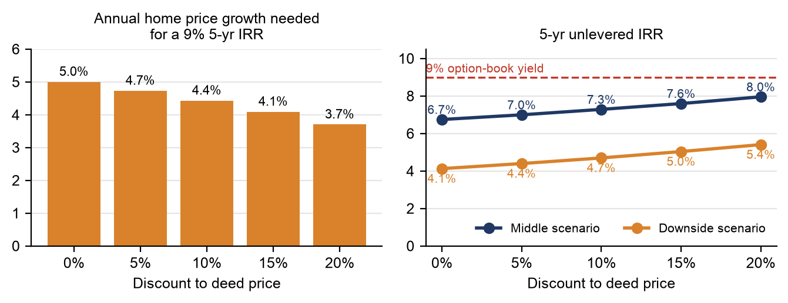

Source: County deed records, Evergreen Live listings, Zillow, Invitation Homes investor presentation (Nov 2025)

**Exhibit 8: Home values in Millrose markets are flat since mid-2022 and 2% below the Feb-2025 peak**
*Zillow home value index (single-family, mid tier, SA), Jan 2020 = 100; Millrose markets = new-home community zips weighted by Millrose $ by state*

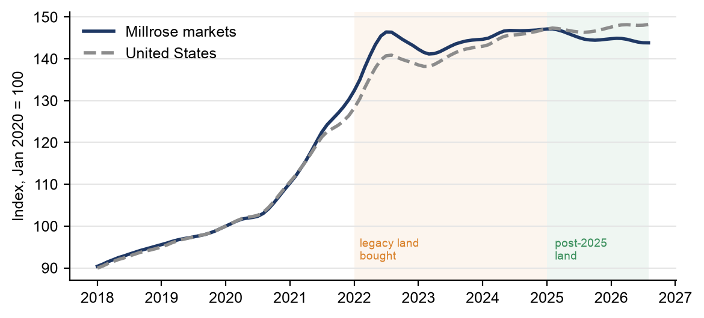

Source: Zillow, Millrose filings, company websites

Put differently, on deed prices the homes would need home price appreciation of ~5% a year to match the ~9% weighted-average yield MRP earns on monthly option payments across its land-banking portfolio, versus a ~6.7% 5-year IRR in our middle scenario. Assuming retail buyers receive similar discounts, the required appreciation falls only modestly with a discount to deed prices: to ~4.7% a year at 5%, ~4.4% at 10%, ~4.1% at 15% and ~3.7% at 20% (Exhibit 7c). Average gross yields of ~8.2% vary by state, with the Southeast highest.

**Bottom line on rental homes: a small pilot that appears to be paused.** We estimate Millrose has spent ~$310mn on ~1,100 homes, ~3% of its homesite book, bought at a median ~3% below the last asking price, mostly in the final week of August. The homes are being leased up rather than acquired tenanted, at gross yields of ~8% and NOI yields of ~4–5.5% on deed prices (~5.5–5.8% if MRP bought at 10–15% discounts like those Invitation Homes has disclosed on builder product), and 5-year unlevered IRRs of ~4–9% on deed prices depending on home prices (~5–10% at a 10–15% discount). The program appears to have paused, and even assuming this pilot goes badly, the impact is small: in an extreme scenario in which home prices fall 5% a year for five years (~23% cumulatively), we estimate the hit to MRP's book value would be about $70mn, ~1% of book value, or less than $0.50 per share, before any rental income. If the scale of investments in rental homes is limited to what has already been invested, we do not see this pilot rental home investments as a material risk to book value.

---

## Exhibit guide: rebuild every chart in Excel

Each exhibit has a data file in [`exhibits/`](exhibits/) and the chart image used above. The data files are tab-separated text, so columns split automatically when pasted, and cells starting with `=` become live formulas.

| Exhibit | What it shows | Data file | Excel chart |
|---|---|---|---|
| 1 | Homes by state | [`ex1_homes_by_state.tsv`](exhibits/ex1_homes_by_state.tsv) | Clustered column (State, Homes) |
| 2 | % of homes deeded per week, by recording date | [`ex2_deeds_by_recording_week.tsv`](exhibits/ex2_deeds_by_recording_week.tsv) | Clustered column of column C (% of dated homes, formula) |
| 2b | % of homes by signing or sale date (433-home sample) | [`ex2b_homes_by_signing_week.tsv`](exhibits/ex2b_homes_by_signing_week.tsv) | Clustered column of column C (% of sampled homes, formula) |
| 3 | MRP price vs. last asking price | [`ex3_price_vs_last_list.tsv`](exhibits/ex3_price_vs_last_list.tsv) | Clustered column (band, % of homes) |
| 4 | Days listed before MRP bought | [`ex4_days_listed.tsv`](exhibits/ex4_days_listed.tsv) | Clustered column |
| 5 | Purchase price bands | [`ex5_purchase_price.tsv`](exhibits/ex5_purchase_price.tsv) | Clustered column |
| 5b | Population density vs. new-home communities, AMH and Invitation Homes | [`ex5b_density.tsv`](exhibits/ex5b_density.tsv) | Clustered bar (Portfolio, Median density); add the percentile as data labels |
| 5c | Asking rents vs. AMH and Invitation Homes, same metros | [`ex5c_rents_vs_peers.tsv`](exhibits/ex5c_rents_vs_peers.tsv) | Clustered column (Metro; Millrose, AMH and Invitation Homes rents); columns H–I give Millrose's gap (formulas) |
| 6 | Gross yield and estimated NOI yield by state | [`ex6_yields_by_state.tsv`](exhibits/ex6_yields_by_state.tsv) | Combo: gross yield as columns, NOI yield (formula = gross × 60%) as markers only |
| 6b | Gross and NOI yield by discount to deed price | [`ex6b_yields_by_discount.tsv`](exhibits/ex6b_yields_by_discount.tsv) | Clustered column (discount; gross and NOI yield, both formulas) |
| 7 | Unlevered IRR by hold period, three scenarios, at deed prices | [`ex7_irr_scenarios.tsv`](exhibits/ex7_irr_scenarios.tsv) | Line with markers; format the "9% core option-book yield" series as a red dashed line with no markers |
| 7b | Same, at a 20% discount to deed prices | [`ex7b_irr_20pct_discount.tsv`](exhibits/ex7b_irr_20pct_discount.tsv) | As for Exhibit 7 |
| 7c | Home price growth needed for a 9% IRR, and 5-yr IRR, by discount to deed price | [`ex7c_irr_by_discount.tsv`](exhibits/ex7c_irr_by_discount.tsv) | Two charts: clustered column (column B) and line with markers (columns C–D); add a 9% horizontal line to the second |
| 8 | Zillow home value index, Millrose markets vs. US | [`ex8_home_value_index.tsv`](exhibits/ex8_home_value_index.tsv) | Line (Month on the horizontal axis) |
| 9 | Rental-home spend vs. homesite book | [`ex9_rental_vs_book.tsv`](exhibits/ex9_rental_vs_book.tsv) | Clustered bar ($ billions) |

**Steps (Excel 2010 or later):**

1. Open a new, blank Excel workbook.
2. Open the exhibit's data file on GitHub, click **Raw**, press **Ctrl+A** then **Ctrl+C**.
3. Click cell **A1** on a blank sheet and press **Ctrl+V**.
4. Select the filled cells and choose **Insert → Recommended Charts**, then pick the chart type listed above.
5. Format percentage columns as **%** if they show decimals (e.g. 0.0866 = 8.66%).
6. **Exhibit 6 only:** right-click the chart → **Change Chart Type → Combo**. Set the NOI yield series to **Line with Markers**, then set its line to **No line**.
7. **Exhibits 7 and 7b:** right-click the 9% series → **Format Data Series**. Set the line to red and dashed, and set markers to **None**.

**Where the numbers come from:** home-level data for Exhibits 1–6 is in [`../mrp_liberty_homes.csv`](../mrp_liberty_homes.csv), and the density data and its Excel checks are in [`../density/`](../density/). Weekly pace and county record checks are in [`../pace/`](../pace/). Return inputs are in [`../irr/`](../irr/), and the Zillow index and forecasts are in [`../zillow/`](../zillow/).

[← Back to the main page](../README.md)
